<div align="center">

# 🪔 Lição em Jogo

**A lição da Escola Sabatina jovem como um jogo presencial: o telão mostra, o celular de cada um joga.**

[](https://licao-em-jogo.vercel.app)


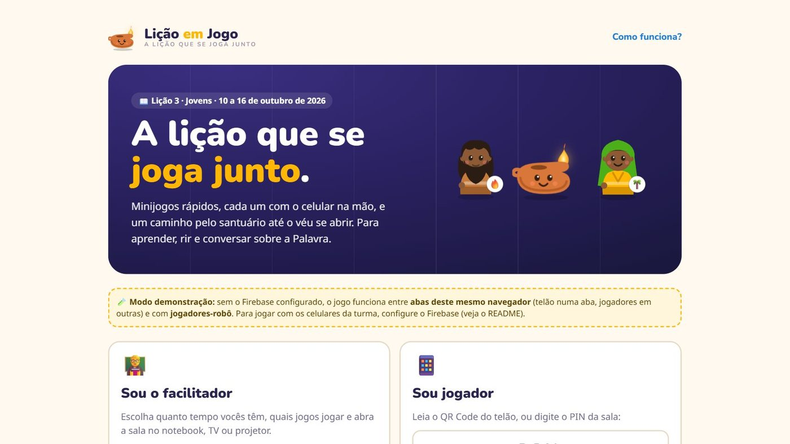

</div>

---

## Sumário

1. [O que é](#o-que-é)
2. [Como a plataforma funciona](#como-a-plataforma-funciona)
3. [Os 12 minijogos](#os-12-minijogos)
4. [Pontuação e o caminho no santuário](#pontuação-e-o-caminho-no-santuário)
5. [Arquitetura](#arquitetura)
6. [Rodar no computador](#rodar-no-computador)
7. [Colocar no ar (Firebase + Vercel)](#colocar-no-ar-firebase--vercel)
8. [Como usar na classe](#como-usar-na-classe)
9. [Testes automáticos com prints](#testes-automáticos-com-prints)
10. [Estrutura do projeto](#estrutura-do-projeto)
11. [Criar o pacote de uma nova lição](#criar-o-pacote-de-uma-nova-lição)
12. [Documentação de design](#documentação-de-design)

---

## O que é

**Lição em Jogo** transforma a lição da Escola Sabatina de jovens em uma partida para a turma toda, no estilo Kahoot com a leveza do Duolingo:

- 📺 **Telão** (TV, projetor ou só o notebook): mostra as perguntas, o mapa, o placar e as histórias da lição.
- 📱 **Celular de cada pessoa**: vira o controle. Entra pelo QR Code ou pelo PIN, sem cadastro e sem instalar nada.
- 🧑‍🏫 **Facilitador (professor)**: só conduz. Avança as telas, julga respostas faladas e puxa a conversa. Não joga.
- 🗺️ **Mapa do santuário**: cada jogo faz o grupo avançar do Átrio até o Santíssimo.
- 💬 **Momento Revelação**: depois de cada jogo, uma enquete anônima e perguntas para conversar sobre o texto bíblico.
- ⏱️ **Planejador**: escolhe os jogos e ajusta as rodadas para a lição caber no tempo (30 a 40 minutos).

O primeiro pacote de conteúdo é a **Lição 3, "Profetas do AT"** (10 a 16 de outubro de 2026, texto-base 1 Reis 19:1-16), para jovens de 15 a 30 anos, com cerca de 15 pessoas. O jogo funciona de 1 a 30 jogadores.

---

## Como a plataforma funciona

### 1. O facilitador monta a aula

No **Planejador**, o facilitador escolhe o tempo e a profundidade (leve, equilibrado ou profundo). A plataforma sugere os jogos, reduz as rodadas para caber no tempo e **bloqueia** o que passaria do limite.

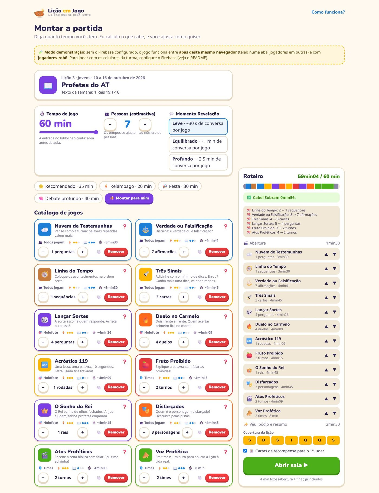

### 2. A turma entra pelo celular

O telão mostra o QR Code e o PIN da sala. Cada pessoa digita o nome, escolhe um personagem bíblico e já está dentro. Quem prefere não aparecer marca "Prefiro não ser sorteado" e joga como plateia nos jogos de holofote.

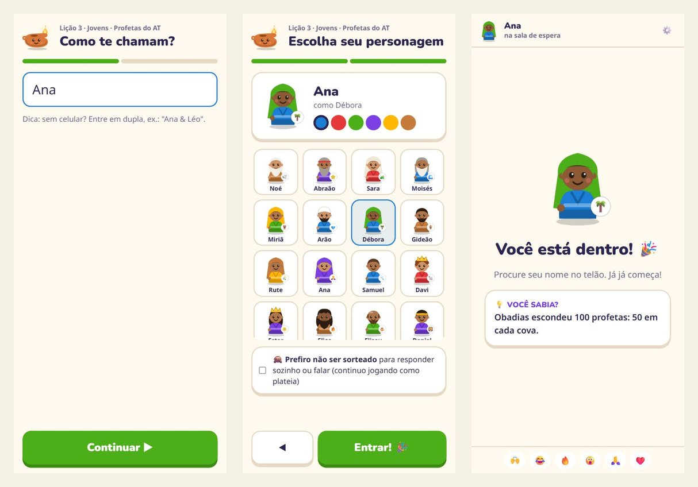

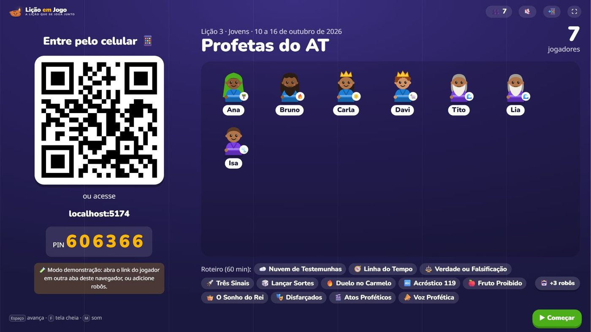

### 3. A partida: o ciclo de cada jogo

Todo jogo segue o mesmo ritmo, então a turma aprende uma vez e já sabe jogar os doze.

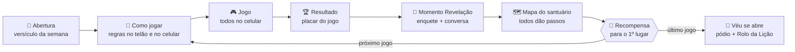

Cada jogo tem uma tela de **"Como jogar"** com os passos ilustrados, no telão e no celular, antes de começar.

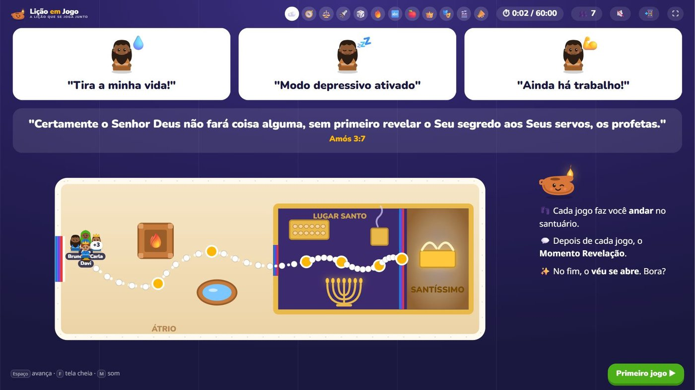

### 4. Momento Revelação

Depois de cada jogo, o telão mostra o que aquele jogo tem a ver com a lição: o versículo, **"Na lição"**, **"Na Bíblia"** (exemplos como Hulda, Débora e Ellen White), uma ideia-síntese e uma pergunta para a turma discutir. Os celulares respondem a uma **enquete anônima** e quem quer falar levanta a mão virtual.

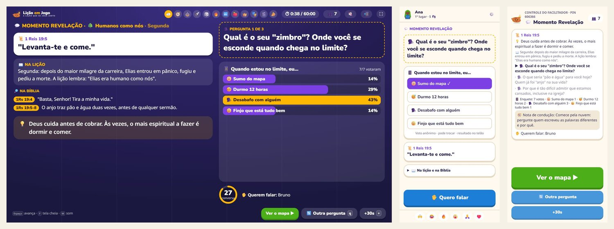

### 5. Mapa, recompensas e pódio

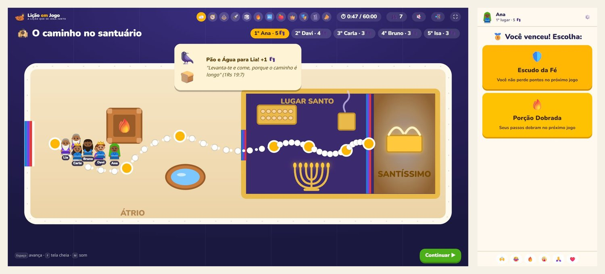

O primeiro lugar de cada jogo ganha uma **carta de recompensa** (Voz de Comando, Porção Dobrada, Escudo da Fé, Lançar a Sorte ou Lâmpada) para usar nos jogos seguintes. No fim, o véu do santuário se abre e aparece o pódio.

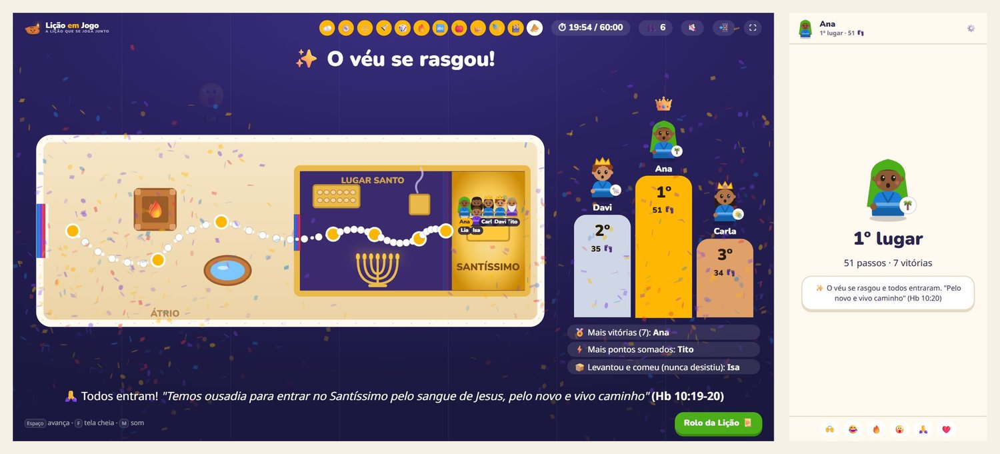

### 6. Rolo da Lição

Ao terminar, a turma recebe o **Rolo da Lição**: um resumo de cada verdade da semana com exemplos bíblicos e uma pergunta para levar para casa. Dá para **baixar como imagem** (formato de story, 1080×1920) e compartilhar.

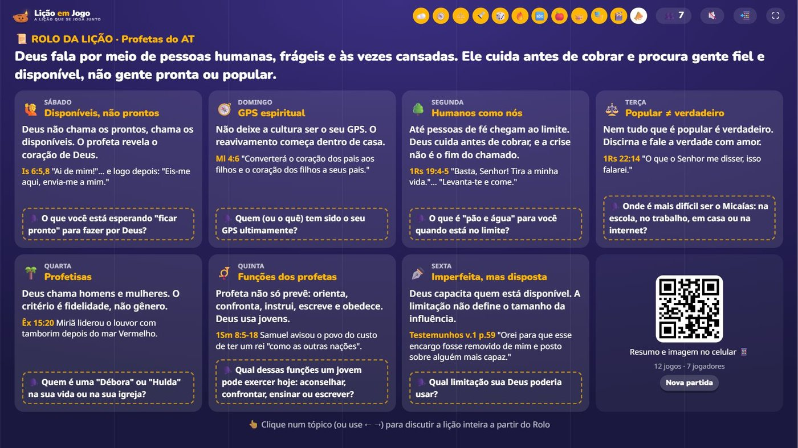

### 7. O controle do facilitador

O facilitador pode usar o próprio celular como controle (botão 📲 no telão): avançar telas, julgar ✓/✗ nos jogos falados e ler notas de condução. Atalhos no telão: `Espaço` avança · `1`/`2` acerto/erro · `F` tela cheia · `M` som.

---

## Os 12 minijogos

Cada linha mostra o **telão** (esquerda) e o **celular** (direita) no jogo. Os prints saem da simulação automática descrita em [Testes automáticos](#testes-automáticos-com-prints).

| Jogo | Quantos jogam | Resumo |
| --- | --- | --- |
| ☁️ Nuvem de Testemunhas | 2+ | Pense como a turma: palavras repetidas valem mais |
| 🧭 Linha do Tempo | 1+ | Coloque os acontecimentos na ordem certa |
| ⚖️ Verdade ou Falsificação | 1+ | Discirna: é verdade ou é falsificação? |
| 🔦 Três Sinais | 1+ | Adivinhe com o mínimo de dicas |
| 🎲 Lançar Sortes | 2+ | A sorte escolhe quem responde: arrisca ou passa? |
| 🔥 Duelo no Carmelo | 2+ | Dois frente a frente: quem acertar primeiro fica no monte |
| 🔤 Acróstico 119 | 2+ | Uma letra, uma palavra, 10 segundos |
| 🍎 Fruto Proibido | 3+ | Explique a palavra sem falar as proibidas |
| 👑 O Sonho do Rei | 4+ | O Rei sonha de olhos fechados: anjos ajudam, falsos profetas enganam |
| 🎭 Disfarçados | 2+ | Quem é o personagem disfarçado? Descubra pelas pistas |
| 🎬 Atos Proféticos | 4+ | Encene a cena bíblica sem falar |
| 📣 Voz Profética | 4+ | Em times: 1 minuto para aplicar a lição à vida real |

### ☁️ Nuvem de Testemunhas

Uma pergunta aparece no telão. Cada um escreve até 3 palavras no celular, de forma **anônima**. A nuvem se forma e as palavras repetidas crescem. O facilitador puxa a conversa a partir delas.

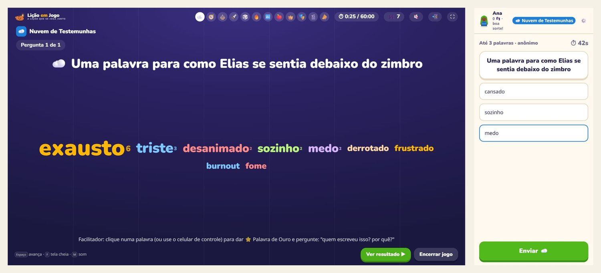

### 🧭 Linha do Tempo

Os acontecimentos chegam embaralhados. Cada um arrasta os cartões (ou usa as setas) até a ordem certa e envia. No telão a jornada é revelada passo a passo.

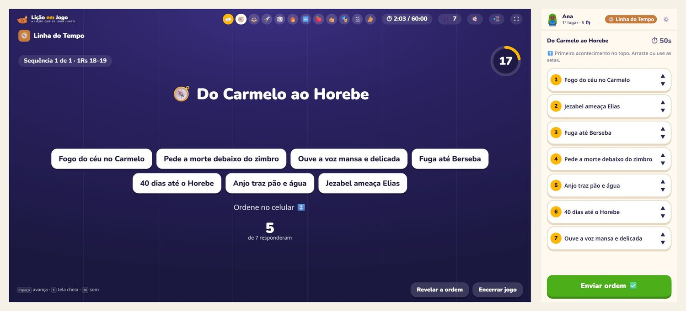

### ⚖️ Verdade ou Falsificação

Uma afirmação sobre a lição aparece no telão. No celular, toque em **VERDADE** ou **FALSIFICAÇÃO**. Depois de cada uma vem a explicação com o versículo.

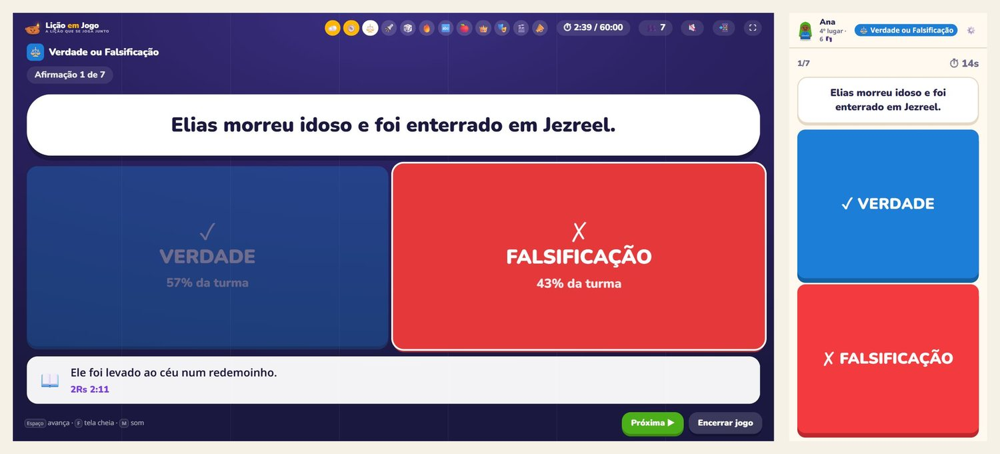

### 🔦 Três Sinais

Estilo "Silvio Santos": todos recebem a dica 1 (a mais difícil) e **digitam** o palpite (a acentuação pode errar). Errou ou tocou em "Não sei"? Abre a próxima dica, só para você, valendo menos. No telão os avatares aparecem conforme cada um acerta, como uma corrida.

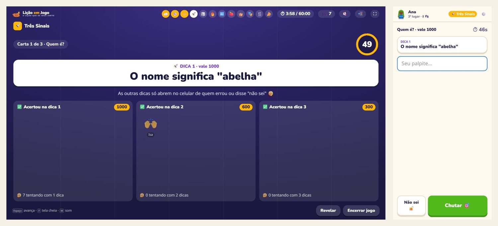

### 🎲 Lançar Sortes

A sorte escolhe **uma** pessoa para responder. Ela pode responder, passar ou pedir ajuda à plateia (uma vez). Se errar ou passar, a pergunta "queima" e vai para outra pessoa. O resto responde em silêncio como plateia. Quem não quer ser sorteado marca "Não me sortear".

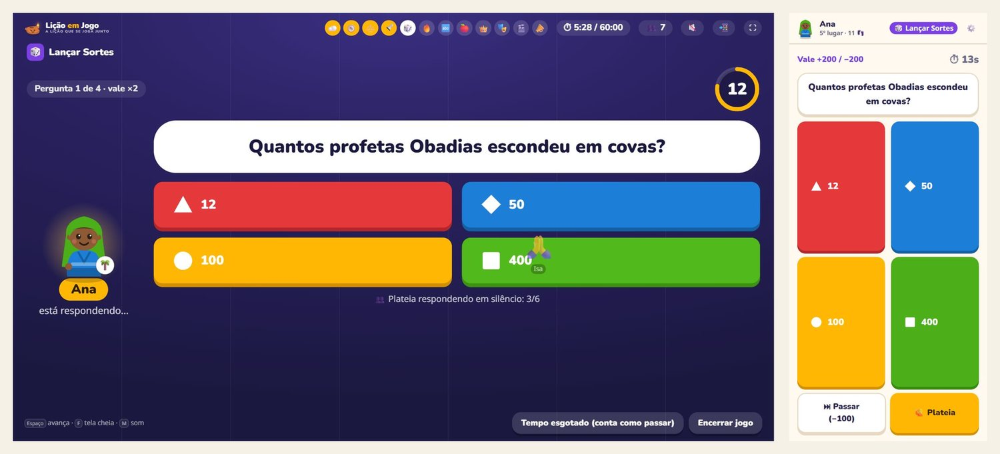

### 🔥 Duelo no Carmelo

Duas pessoas são sorteadas para um duelo de uma pergunta. Quem acertar **primeiro** vence e fica no monte (Rei do Monte) para enfrentar um novo desafiante. A plateia aposta em quem vence.

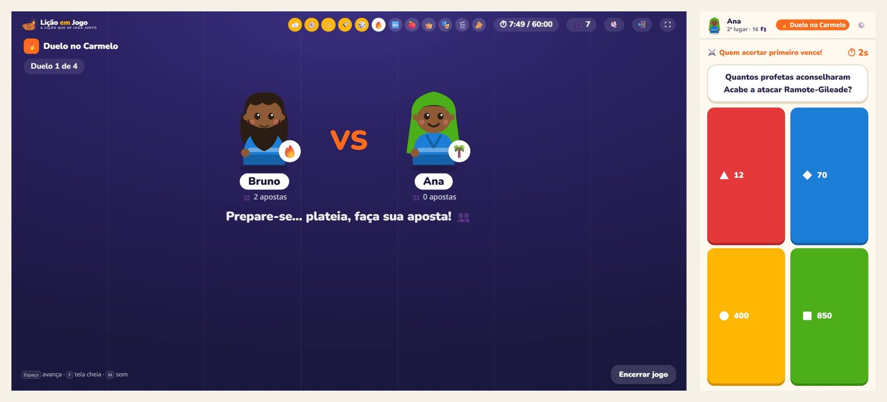

### 🔤 Acróstico 119

Um tema aparece no telão. Na sua vez, **fale** uma palavra do tema e toque na letra inicial dela. A letra fica travada até o fim da rodada e você tem 10 segundos. A turma vota se vale, e quem falhar sai da rodada.

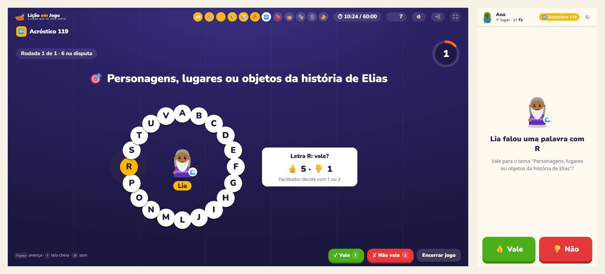

### 🍎 Fruto Proibido

A turma vira 2 ou 3 times (com menos de 6 pessoas, cada um joga por si). Quem explica vê a palavra e 5 palavras **proibidas** só no próprio celular e tem 60 segundos. Um fiscal do outro time vê a mesma carta e aperta **BUZZ** se ouvir uma proibida.

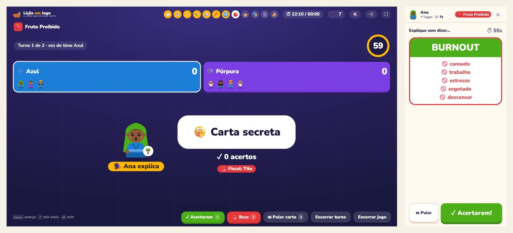

### 👑 O Sonho do Rei

Uma pessoa é o **Rei** e fica de costas, de olhos fechados. Os outros recebem um papel secreto no celular: **Anjo**, **Falso Profeta** ou **Mago da Corte**. Cada um diz uma palavra de pista e o Rei tenta discernir quem está ajudando e quem engana. Inspirado em Daniel 2.

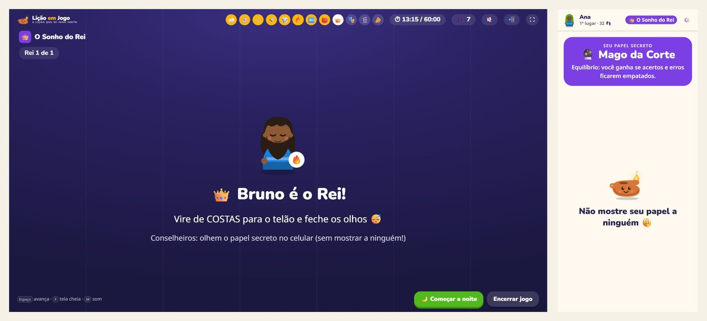

### 🎭 Disfarçados

Um **informante** recebe um personagem secreto e dá pistas ("Hoje seria preso…"). Todos veem 12 personagens no telão e votam no celular, um palpite só. Neste jogo não entram textos de Ellen White nas pistas.

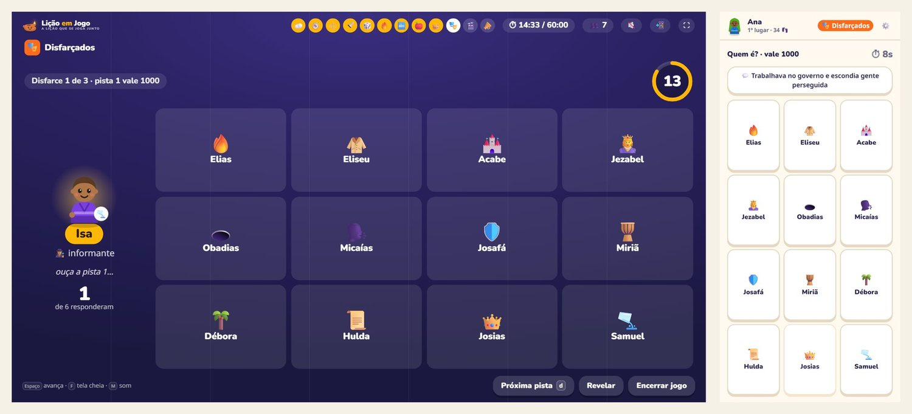

### 🎬 Atos Proféticos

Em times, um **ator** do time da vez escolhe no celular uma cena fácil (100) ou difícil (200) e encena **sem falar** por 60 segundos. O time adivinha em voz alta. Se o tempo acabar, os outros times podem roubar com um palpite.

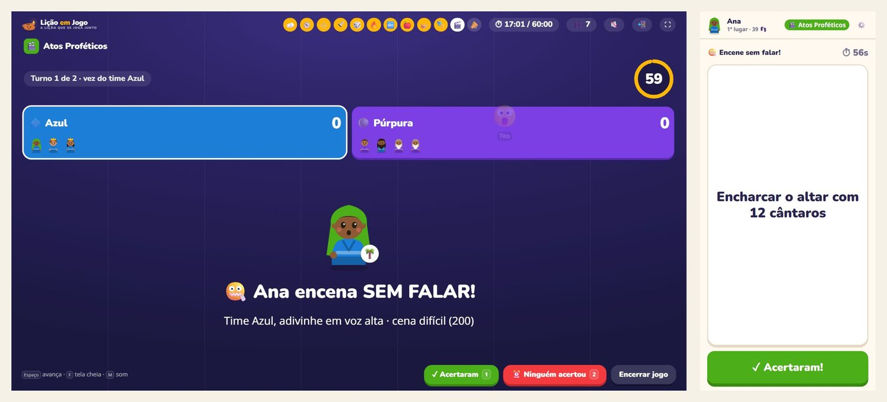

### 📣 Voz Profética

Cada time recebe um caso da vida real e tem 3 minutos para montar: **situação hoje → o que a Palavra diz → atitude prática**. Cada time faz 1 minuto de pitch e todos avaliam os **outros** times em "Fiel ao texto" e "Prático para a vida".

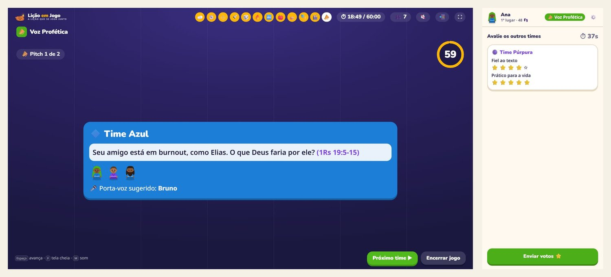

---

## Pontuação e o caminho no santuário

A pontuação funciona igual para 3 ou para 30 jogadores, porque cada jogo vira **passos** no mapa, e não pontos soltos.

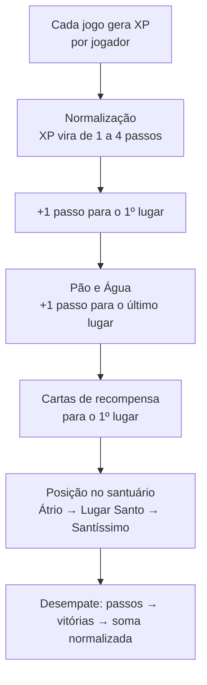

- **Velocidade (estilo Kahoot):** nas perguntas com tempo, `pontos = round(1000 × (1 − t / (2T)))`, onde `t` é o tempo gasto e `T` o tempo da pergunta.
- **Passos:** cada jogo reparte de 1 a 4 passos conforme a posição do jogador, com +1 para quem vence. Quem fez pontos negativos recebe 0.
- **Pão e Água:** o último colocado ganha +1 passo. Ninguém fica para trás, como o anjo que alimentou Elias ("Levanta-te e come").
- **Recompensas** para o 1º lugar de cada jogo, valendo no jogo seguinte:
  - 🗳️ **Voz de Comando**: escolhe o próximo jogo.
  - 🔥 **Porção Dobrada**: os passos dobram (2 Reis 2:9).
  - 🛡️ **Escudo da Fé**: não perde pontos (Efésios 6:16).
  - 🎲 **Lançar a Sorte**: escolhe quem será sorteado primeiro (Provérbios 16:33).
  - 🕯️ **Lâmpada**: uma ajuda extra, como alternativas apagadas ou a letra inicial (Salmo 119:105).
- **Lançar Sortes** mantém pontos negativos para dar risco de verdade, e por isso existe o "Não me sortear".

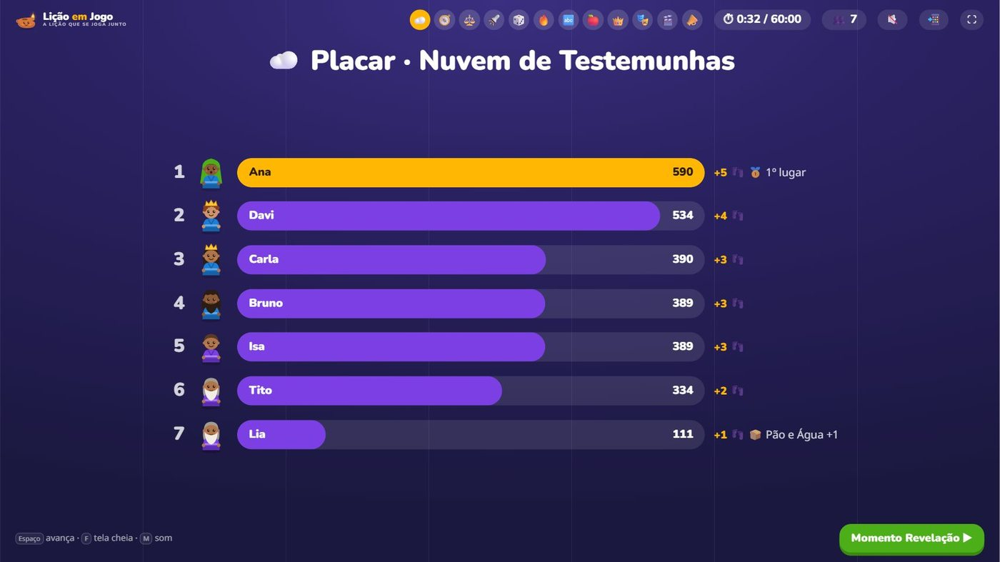

---

## Arquitetura

### Visão geral

O **telão é a autoridade do jogo** (*host-authoritative*): ele roda a máquina de estados, calcula os resultados e publica o que cada tela deve mostrar. Os celulares só enviam o que o jogador fez (um toque, uma palavra). Isso deixa o banco de dados simples e as regras de segurança curtas.

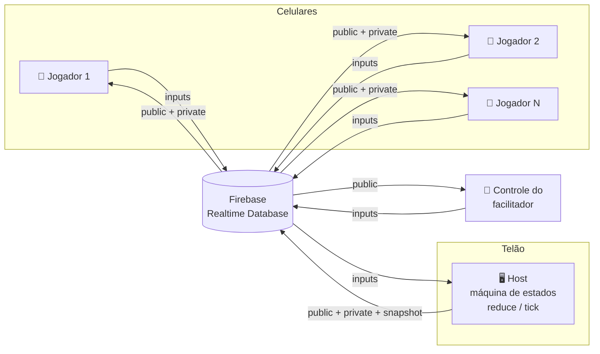

| Caminho no banco | Quem escreve | Quem lê | Para quê |
| --- | --- | --- | --- |
| `rooms/{pin}/meta` | Telão | Todos | Dono da sala (`hostUid`) |
| `rooms/{pin}/public` | Telão | Todos | O que todas as telas mostram agora |
| `rooms/{pin}/private/{uid}` | Telão | Só o próprio jogador | Papel secreto, palavras proibidas, dicas |
| `rooms/{pin}/inputs` | Cada jogador (só o próprio `pid`) | Telão | Ações dos jogadores |
| `rooms/{pin}/snapshot` | Telão | Telão | Retomar a partida se a internet cair |
| `rooms/{pin}/presence/{uid}` | Cada jogador | Telão | Quem está online |

Os jogadores entram com **login anônimo** do Firebase. As regras ficam em [`database.rules.json`](database.rules.json): só o dono da sala escreve o estado do jogo, e cada jogador só lê o próprio papel secreto. Por isso o "Sonho do Rei" e o "Fruto Proibido" não vazam informação para quem não deve ver.

### Camadas do código

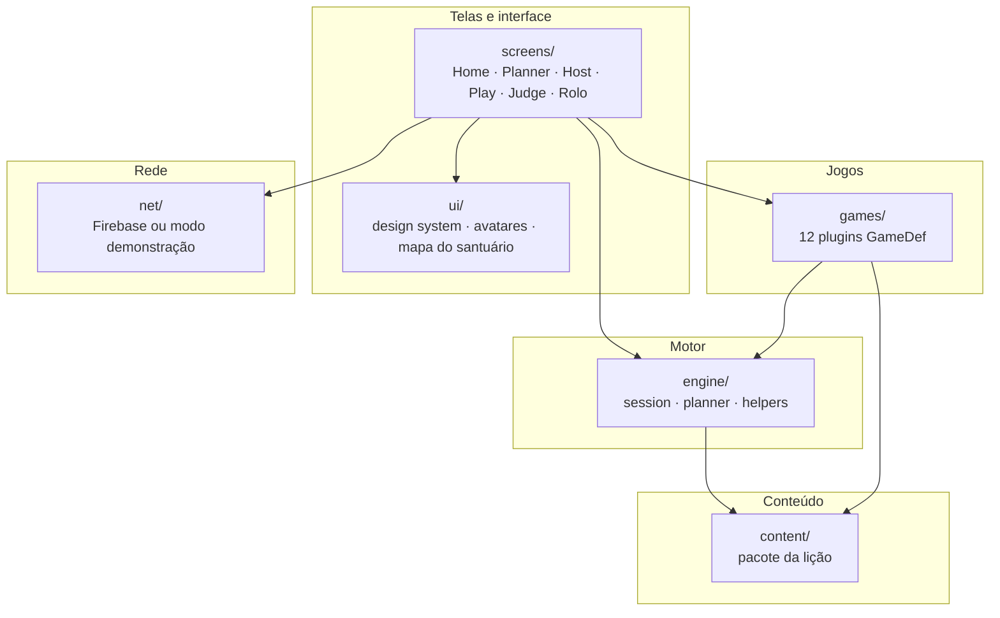

- **Cada jogo é um plugin** (`GameDef`, em `src/engine/types.ts`) com `init`, `input`, `tick`, `scores`, `publicView`, `privateView`, `controls`, `bot` e as telas `HostView` e `PlayerView`. Para criar um 13º jogo basta escrever um novo arquivo em `src/games/` e registrá-lo em `src/games/index.ts`.
- **O motor** (`src/engine/session.ts`) é uma função pura `reduce(state, evento)`. Isso torna o jogo previsível, fácil de testar e fácil de retomar de um *snapshot*.
- **Robôs** (`bot` em cada jogo) permitem testar sozinho e completar times.
- **O planejador** (`src/engine/planner.ts`) estima o tempo de cada jogo (4 minutos fixos de abertura e final, mais o custo de cada rodada e do Momento Revelação) e reduz as rodadas até caber.
- **Modo demonstração** (`src/net/local.ts`): sem Firebase configurado, o telão e os jogadores conversam por `BroadcastChannel` entre abas do mesmo navegador. É o que roda quando você clona o projeto e executa `npm run dev` pela primeira vez.

### Tecnologias

| Camada | Escolha |
| --- | --- |
| Interface | React 19, TypeScript 5.9, Vite 7 |
| Estilo | Tailwind CSS 4, design system próprio "Tabernáculo" (fontes Nunito e Noto Sans) |
| Animação | `motion`, `canvas-confetti` |
| Tempo real | Firebase Realtime Database + Authentication anônimo |
| QR Code e imagem | `qrcode.react`, `html-to-image` (Rolo da Lição) |
| Hospedagem | Vercel (site) e Firebase Spark (banco), ambos gratuitos |
| Testes visuais | Playwright dirigindo o Microsoft Edge |

---

## Rodar no computador

```bash
npm install
npm run dev
```

Abra `http://localhost:5173`.

Sem Firebase configurado, o jogo roda em **modo demonstração**:

- o telão fica numa aba e os jogadores em outras abas **do mesmo navegador**;
- na sala de espera, o botão **🤖 +3 robôs** adiciona jogadores automáticos para testar sozinho.

Outros comandos úteis:

```bash
npm run typecheck   # checagem de tipos
npm run build       # build de produção em dist/
npm run simular     # simulação visual completa dos 12 jogos (cerca de 20 min)
npm run testar:online   # teste rápido: telão + 3 celulares isolados pelo Firebase
```

---

## Colocar no ar (Firebase + Vercel)

Para jogar com os celulares da turma é preciso configurar o Firebase e publicar o site. Os dois têm plano gratuito.

### Firebase

1. Crie um projeto em <https://console.firebase.google.com> (plano Spark).
2. **Build → Authentication → Sign-in method:** ative **Anônimo**.
3. **Build → Realtime Database:** crie o banco (região `us-central1` ou a mais próxima).
4. Publique as regras:
   ```bash
   npx firebase-tools@latest login
   npx firebase-tools@latest deploy --only database --project SEU-PROJETO
   ```
5. **Configurações do projeto → Seus apps → Web (`</>`):** registre um app e copie a configuração.
6. Copie `.env.example` para `.env.local` e preencha:
   ```
   VITE_FIREBASE_API_KEY=...
   VITE_FIREBASE_AUTH_DOMAIN=...
   VITE_FIREBASE_DATABASE_URL=https://SEU-PROJETO-default-rtdb.firebaseio.com
   VITE_FIREBASE_PROJECT_ID=...
   VITE_FIREBASE_APP_ID=...
   ```
7. Rode de novo `npm run dev`. O aviso de "modo demonstração" some.

> A `apiKey` do Firebase Web não é segredo: ela vai no JavaScript do navegador de qualquer app. Quem protege os dados são as regras do `database.rules.json`.

### Vercel

1. Em <https://vercel.com/new>, importe o repositório (ou use `npx vercel@latest`). O framework **Vite** é detectado sozinho.
2. Em **Settings → Environment Variables**, cadastre as 5 variáveis `VITE_FIREBASE_*`.
3. Faça o deploy. O QR Code do telão aponta sozinho para `https://seu-projeto.vercel.app/j/PIN`.

O `vercel.json` já redireciona todas as rotas para o app (`/host/...`, `/j/...`, `/f/...`).

Para atualizar depois: `npx vercel@latest deploy --prod`.

---

## Como usar na classe

1. **Antes da aula:** abra o site no notebook, escolha **Criar sala**, defina o tempo (por exemplo, 35 minutos) e os jogos, e clique em **Abrir sala**. A turma entra pelo QR enquanto chega.
2. **Telão:** conecte o notebook à TV ou ao projetor e aperte `F` para tela cheia. Sem telão, projete só no notebook e deixe todos jogarem no celular.
3. **Controle no celular (opcional):** no telão, clique em 📲 e leia o QR com o seu celular para avançar, julgar ✓/✗ e ver as notas de condução.
4. **Durante o jogo:** deixe a conversa acontecer no Momento Revelação. É ali que a lição é discutida.
5. **Se a internet cair:** abra o mesmo link de novo. O telão retoma de onde parou e cada jogador volta para o próprio personagem.

---

## Testes automáticos com prints

O script [`scripts/simular-partida.mjs`](scripts/simular-partida.mjs) abre o Microsoft Edge em modo invisível com 6 abas (1 telão, 4 celulares e o controle do facilitador, mais 3 robôs) e **joga os 12 jogos agindo em cada papel**, tirando prints do telão, do celular e do controle.

```bash
npm run dev       # em um terminal
npm run simular   # em outro (cerca de 20 minutos)
```

O resultado é o relatório [`docs/testes/RELATORIO.md`](docs/testes/RELATORIO.md), com cerca de 170 prints em [`docs/testes/prints/`](docs/testes/prints/). Na última execução: **12 de 12 jogos concluídos e nenhum erro de JavaScript**.

Para validar a sincronização pela internet (cada celular em um navegador isolado, sem compartilhar abas), use:

```bash
BASE=https://licao-em-jogo.vercel.app npm run testar:online
```

---

## Estrutura do projeto

```
src/
  content/      pacote da lição (perguntas, cartas, verdades, estações…)
  engine/       regras da sessão, pontuação → passos, planejador de tempo
  games/        os 12 minijogos (lógica + tela do telão + tela do celular)
  net/          tempo real: Firebase ou modo demonstração (BroadcastChannel)
  screens/      Início, Como funciona, Planejador, Telão, Jogador, Controle, Rolo
  ui/           design system: botões 3D, avatares SVG, mascote Lume, mapa do santuário
scripts/        simulação visual e teste online
docs/           planejamento, game design e relatório de testes
database.rules.json   regras de segurança do Realtime Database
vercel.json           redireciona todas as rotas para o app
```

---

## Criar o pacote de uma nova lição

Todos os jogos leem o conteúdo de um **pacote** (`ContentPack`). Para a próxima lição:

1. Copie `src/content/l03-profetas.ts` e `src/content/l03-discussao.ts`.
2. Troque perguntas, cartas, verdades e o Momento Revelação de cada jogo.
3. Registre o novo pacote em `src/content/index.ts`.

Nenhuma linha de jogo precisa mudar.

---

## Documentação de design

O planejamento completo do projeto está em [`docs/`](docs/):

| Documento | Conteúdo |
| --- | --- |
| [01 · Conteúdo da lição](docs/01-conteudo-da-licao.md) | A lição organizada em verdades, versículos e exemplos |
| [02 · Referências de design e jogos](docs/02-referencias-design-e-jogos.md) | Pesquisa em Kahoot, Duolingo e jogos de grupo |
| [03 · Game design](docs/03-game-design.md) | Regras, pontuação, mapa, tempos e decisões tomadas |
| [04 · Banco de conteúdo](docs/04-banco-de-conteudo.md) | Perguntas, cartas e desafios de cada jogo |
| [Relatório de testes](docs/testes/RELATORIO.md) | Execução dos 12 jogos com prints |

---

<div align="center">

Feito para tornar a lição mais viva. 🪔

</div>
