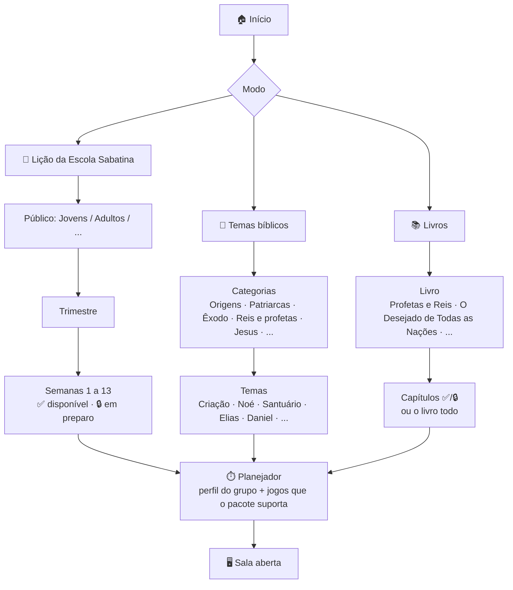
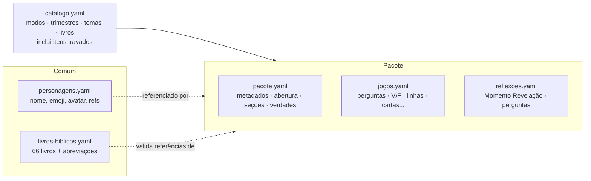
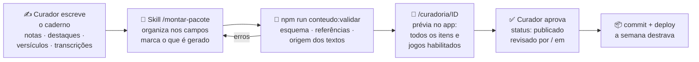

# 05 · Arquitetura: base de conhecimento, modos de jogo e crescimento

> Status: **fases 0, 1 e 2 implementadas** (17/10/2026); o resto é proposta. O andamento fica em [`ESTADO.md`](ESTADO.md).
> Diferenças do que foi implementado em relação a esta proposta: o esquema Zod ficou em `scripts/conteudo/esquema.ts` (o app não precisa dele); a versão do pacote vai como `?v=<hash>` na URL, não no nome do arquivo; a capacidade de cada jogo é calculada no app (`maxRoundsFor`), não gravada no catálogo.
> Objetivo: sair de "o jogo da Lição 3" para "uma plataforma que joga qualquer conteúdo cristão curado por pessoas", crescendo aos poucos, de graça, sem IA interpretando a Bíblia.

---

## 1. Princípios (valem para tudo que vier depois)

1. **Pessoas interpretam, a IA só formata.** Toda reflexão, aplicação, ênfase, "insight" e pergunta de discussão nasce de um curador humano. A IA (Claude, numa skill do projeto) pode organizar o texto do curador nos campos certos e criar itens mecânicos de jogo, sempre marcados para revisão. Isso é verificado por código, não só por boa vontade (seção 5).
2. **Nenhuma IA dentro do jogo.** O jogo é determinístico: lê pacotes de conteúdo estáticos e não chama nenhuma API de IA. Não existe "envie um PDF e a IA monta o jogo".
3. **O conteúdo cresce em pacotes pequenos.** A unidade é o **pacote** (uma semana da lição, um tema, um capítulo de livro). Um pacote pode começar pequeno e ganhar jogos com o tempo.
4. **O que não está pronto aparece travado.** O catálogo lista também o que ainda não existe, para o grupo ver o caminho e o curador ver o que falta.
5. **Conteúdo separado do código.** Curar uma semana nova não exige mexer em jogo nenhum.
6. **Gratuito primeiro.** Arquivos no Git, site estático na Vercel, Firebase só para o tempo real das partidas. Nada que exija servidor pago até haver necessidade comprovada.
7. **Transparência.** Cada pacote mostra quem fez a curadoria e de quais fontes veio.

---

## 2. Os três modos e a escolha no menu inicial



- **Lição da Escola Sabatina:** público (jovens, adultos e, no futuro, outros) → trimestre → semana. Semanas sem pacote publicado aparecem com cadeado e o título "em preparo".
- **Temas bíblicos:** categorias com as grandes histórias. Cada tema é um pacote independente da data.
- **Livros:** livros de Ellen G. White (e, no futuro, outros) → capítulos. "Livro todo" junta os capítulos já publicados.
- **Combinar** (fase posterior): escolher mais de um pacote para uma revisão, por exemplo "trimestre todo" ou "Gênesis 1 a 11".

### Perfil do grupo (mesma plataforma, contextos diferentes)

O planejador ganha **perfis**, que só mudam os valores iniciais:

| Perfil | Tempo sugerido | Profundidade | Ajustes |
| --- | --- | --- | --- |
| Classe da Escola Sabatina | 30 a 40 min | Equilibrado | Como hoje |
| Pequeno Grupo (PG / célula) | 45 a 60 min | Profundo | Mais tempo no Momento Revelação, mais jogos de conversa |
| Família em casa | 20 a 30 min | Leve | Sem pontos negativos, jogos simples, itens marcados para crianças |
| Evento ou retiro | 60 a 90 min | Equilibrado | Times maiores, mais jogos de palco |

Os itens de conteúdo podem ter a etiqueta `publico` (crianças, jovens, adultos, todos) para o perfil Família filtrar o que é adequado.

---

## 3. Modelo de conteúdo

### 3.1 Antes da fase 0

Um único `ContentPack` em TypeScript (`src/content/l03-profetas.ts` + `l03-discussao.ts`), importado direto no bundle. `getPack(id)` sempre cai no pacote da Lição 3. Cada jogo lê um ou dois campos do pacote:

| Jogo | Campo(s) do pacote |
| --- | --- |
| Nuvem de Testemunhas | `cloudPrompts` |
| Linha do Tempo | `timelines` |
| Verdade ou Falsificação | `trueFalse` |
| Três Sinais | `threeSigns`, `characters` |
| Lançar Sortes, Duelo no Carmelo | `questions` |
| Acróstico 119 | `acrosticThemes` |
| Fruto Proibido | `taboo` |
| O Sonho do Rei | `dreamWords` |
| Disfarçados | `characters`, `disguiseClues` |
| Atos Proféticos | `mimes` |
| Voz Profética | `pitchCases` |
| Momento Revelação | `revelations` (uma por jogo) |
| Rolo da Lição | `truths`, `summary` |

Esse mapeamento limpo é a melhor notícia: dá para generalizar sem reescrever os jogos.

### 3.2 Proposta: catálogo + pacotes + conteúdo comum



**Catálogo** (`conteudo/catalogo.yaml`): a árvore do menu. Lista tudo, publicado ou não.

```yaml
licao:
  - publico: jovens
    trimestres:
      - id: 2026-t4
        titulo: "4º trimestre de 2026"
        semanas:
          - { n: 1, titulo: "…", datas: "26/9 a 2/10" }                       # 🔒 sem pacote
          - { n: 3, titulo: "Profetas do AT", datas: "10 a 16/10", pacote: licao-2026-t4-jovens-s03 }
temas:
  - categoria: Origens
    itens:
      - { id: tema-criacao, titulo: "A Criação", pacote: null }               # 🔒
      - { id: tema-noe, titulo: "Noé e o dilúvio", pacote: tema-noe }
livros:
  - id: egw-profetas-e-reis
    titulo: "Profetas e Reis"
    autor: "Ellen G. White"
    capitulos:
      - { n: 14, titulo: "No espírito e virtude de Elias", pacote: null }     # 🔒
```

Uma entrada sem `pacote` (ou com pacote em `rascunho`) aparece travada no menu.

**Pacote**: o mesmo `ContentPack` de hoje, generalizado:

- `tipo: licao | tema | livro` e metadados (`titulo`, `publico`, `versao`, `status`).
- `curadoria`: quem curou e quando revisou. Aparece no jogo ("Conteúdo preparado por …").
- `fontes`: de onde veio (lição, capítulo, vídeo com URL e autor, anotações próprias).
- `secoes` no lugar de `day`: na lição são os 7 dias; num tema são as partes da história; num capítulo, os blocos do capítulo. `Truth.day` vira `Truth.secao`.
- `personagens`: referências a `comum/personagens.yaml` + pistas específicas do pacote. O mesmo Elias serve para a Lição 3, para o tema "Elias" e para o capítulo de Profetas e Reis, com o mesmo avatar.
- `reflexoes` (o atual `revelations`): deixam de ser obrigatoriamente "uma por jogo". Se houver uma específica para o jogo, ela é usada; se não, o jogo usa a próxima reflexão geral do pacote. Assim um pacote pequeno já funciona.
- Os campos de jogo continuam iguais (perguntas, V/F, linhas do tempo, cartas…). Todos são **opcionais**.

### 3.3 Cada jogo declara o que precisa

Cada `GameDef` ganha uma função `capacidade(pacote)` que diz quantas rodadas o pacote permite (por exemplo, Verdade ou Falsificação precisa de pelo menos 5 afirmações). O planejador:

- mostra só os jogos que o pacote suporta, e os outros travados com o motivo ("este pacote ainda não tem cartas de Fruto Proibido");
- limita o máximo de rodadas ao que existe.

**Pacote mínimo jogável:** abertura (título, versículo e ideia central), ao menos uma seção com verdade, uma reflexão e conteúdo para **3 jogos**. Um tema novo pode nascer só com perguntas, Verdade ou Falsificação e uma Linha do Tempo, e ganhar os jogos de palco depois.

### 3.4 Identificadores e versões

- `licao-2026-t4-jovens-s03`, `tema-noe`, `livro-egw-profetas-e-reis-c14`.
- `versao` sobe a cada publicação. O arquivo gerado leva um hash (`tema-noe.3f9a1c.json`). A sala guarda `packId` + versão, então uma partida em andamento não quebra se o pacote for atualizado no meio dela.

### 3.5 Onde o conteúdo mora e como chega ao jogo

```
conteudo/
  REGRAS.md                       regras de curadoria (fonte única para pessoas e para o Claude)
  catalogo.yaml
  comum/
    livros-biblicos.yaml
    personagens.yaml
  pacotes/
    licao/2026-t4-jovens/s03-profetas-do-at/
      pacote.yaml  jogos.yaml  reflexoes.yaml
    temas/noe/
      pacote.yaml  jogos.yaml  reflexoes.yaml
    livros/egw-profetas-e-reis/c14/
      pacote.yaml  jogos.yaml  reflexoes.yaml
  fontes/                         caderno do curador (privado, ver 5.4)
    tema-noe/
      notas.md  destaques.md  versiculos.md  reflexoes.md  transcricoes/
scripts/conteudo/
  validar.ts                      esquema + regras de origem (seção 5.3)
  construir.ts                    YAML → public/conteudo/*.json + catalogo.json
  novo-pacote.ts                  cria a pasta de um pacote a partir de um modelo
src/content/
  schema.ts                       esquema (Zod) usado pelo validador e pelo app
  loader.ts                       busca catalogo.json e pacotes sob demanda, com cache
public/conteudo/                  GERADO pelo build (não se edita à mão)
```

- **Formato YAML** para quem escreve: aceita comentários, textos longos e é legível sem programar. O app recebe JSON gerado.
- **Carregamento sob demanda:** o app baixa `catalogo.json` no início e só o pacote escolhido ao criar a sala. Os celulares baixam o mesmo pacote pelo `packId` da sala. O bundle não cresce com o conteúdo, e o conteúdo vem da CDN da Vercel, não do Firebase.
- **Git como banco de dados de conteúdo:** histórico, revisão por pull request, de graça. Não precisa de painel administrativo por enquanto.

---

## 4. Fluxo de curadoria (do caderno ao jogo)



1. **Caderno do curador** (`conteudo/fontes/<id>/`), escrito à mão, em Markdown livre:
   - `notas.md`: a sua leitura e interpretação, o que quer destacar e as mensagens a enfatizar;
   - `destaques.md`: frases e trechos que devem aparecer como estão;
   - `versiculos.md`: a lista de referências que podem ser usadas (uma por linha, com o texto se quiser exibir);
   - `reflexoes.md`: reflexões e perguntas de discussão, do jeito que você faria em classe;
   - `transcricoes/`: transcrições de vídeos (com URL, autor e data no topo), de onde você marca os trechos que valem.
2. **Skill `/montar-pacote <id>`** (Claude Code): lê o caderno e preenche `pacote.yaml`, `jogos.yaml` e `reflexoes.yaml` seguindo `conteudo/REGRAS.md`. Gera também `revisao.md` com tudo o que precisa de olhar humano.
3. **Validador** (código, sem IA): bloqueia o que viola as regras (seção 5.3).
4. **Prévia** em `/curadoria/<id>` (página escondida do app): mostra cada item como vai aparecer, marca em amarelo o que foi gerado e lista os jogos habilitados e travados.
5. **Publicação:** só o curador muda `status` para `publicado` e preenche `curadoria.revisadoEm`. Depois é commit e deploy.

Também funciona **sem IA nenhuma**: o curador pode escrever o YAML direto, com o modelo de `novo-pacote`.

---

## 5. Guardas contra interpretação por IA

### 5.1 Três tipos de campo

Todo campo do esquema é classificado:

| Tipo | Exemplos | Quem escreve | Regra |
| --- | --- | --- | --- |
| **Interpretativo** | ideia central, verdades, "Na lição", insight, reflexões, perguntas de discussão, aplicações, enquetes, casos da Voz Profética | **Só o curador** | O texto tem de existir no caderno (cópia literal, com tolerância só de espaços e pontuação) |
| **Factual** | enunciado de pergunta, afirmação de V/F, eventos da Linha do Tempo, pistas, bios | Curador, ou a IA a partir de um fato do caderno | Precisa citar uma referência que esteja em `versiculos.md`; se a IA redigiu, fica `origem: gerado` |
| **Mecânico** | alternativas erradas, palavras proibidas, letras do acróstico, palavras do Sonho, mímicas, respostas aceitas | IA pode criar | Fica `origem: gerado` e entra na revisão |

### 5.2 O que a skill pode e não pode fazer

**Pode:**
- copiar texto do caderno para o campo certo;
- dividir um texto do curador em itens (uma reflexão por seção, por exemplo);
- redigir perguntas e afirmações factuais sobre o que o texto bíblico narra, usando só referências da lista do curador;
- criar itens mecânicos (distratores, palavras proibidas, mímicas);
- apontar lacunas ("a seção 4 não tem reflexão"; "faltam 3 afirmações para habilitar Verdade ou Falsificação").

**Não pode:**
- escrever reflexão, aplicação, moral da história, insight, oração ou pergunta de discussão;
- explicar profecia, doutrina ou o "significado" de um texto;
- citar versículo, livro ou autor que não esteja no caderno;
- citar Ellen G. White, a lição ou outra fonte fora de `destaques.md`;
- reescrever a interpretação do curador "para ficar melhor". Se um texto não couber no campo, ela avisa em `revisao.md` em vez de encurtar;
- mudar `status` para `publicado`.

Sugestões que a skill julgar úteis (por exemplo, uma pergunta de discussão) vão para `revisao.md` como **sugestão**, fora do pacote. Só entram se o curador copiar para o próprio caderno, o que transforma a ideia em decisão dele.

### 5.3 O que o validador verifica (código, sem IA)

- **Esquema:** tipos, campos obrigatórios, tamanhos máximos (cabe na tela do celular).
- **Referências bíblicas:** cada `ref` é interpretada com `livros-biblicos.yaml` ("1Rs 19:4" → 1 Reis 19:4) e precisa existir na lista de `versiculos.md` do pacote.
- **Origem dos campos interpretativos:** o texto precisa ser encontrado no caderno. Se a IA inventou uma reflexão, o build falha.
- **Citações:** trechos atribuídos a Ellen G. White, à lição ou a um vídeo precisam estar literalmente em `destaques.md` ou na transcrição indicada.
- **Itens gerados:** contados e listados; pacote com item gerado não revisado não pode ser `publicado`.
- **Capacidade:** calcula quais jogos o pacote habilita e grava isso no catálogo gerado.

Essa checagem de origem precisa do caderno, que fica no computador do curador (ver 5.4). No GitHub Actions roda só a parte que não depende dele (esquema, referências, capacidade).

### 5.4 Fontes, privacidade e direitos autorais

- O texto da lição (CPB / Associação Geral), traduções bíblicas em português (SBB e outras) e as edições em português de Ellen G. White têm direitos autorais. O pacote público deve trazer **as palavras do curador** e **trechos curtos com referência**, não cópias longas. Vale confirmar as permissões de cada tradução antes de exibir versículos completos.
- Transcrições de vídeos de terceiros não devem ficar num repositório público. Sugestão: `conteudo/fontes/` fica fora do repositório público (no `.gitignore`) e é guardada num **repositório privado** separado (gratuito no GitHub). O pacote publicado registra a fonte (URL, autor), não a transcrição.
- O repositório atual é público e tem `docs/01-conteudo-da-licao.md` e `docs/04-banco-de-conteudo.md`. Vale revisar se há trechos longos da lição copiados ali.

---

## 6. Escala: muitos grupos, em muitos lugares, de graça

### 6.1 O que já escala hoje

Cada sala é isolada pelo PIN no Realtime Database (`rooms/{pin}`). Uma igreja em Recife, um PG em Campinas e uma família em casa podem jogar ao mesmo tempo sem se enxergar. O telão é a autoridade de cada sala, então não existe servidor central para escalar.

### 6.2 Os limites gratuitos que importam

| Serviço | Limite gratuito | O que significa |
| --- | --- | --- |
| Firebase Realtime Database (Spark) | **100 conexões simultâneas**, 1 GB armazenado, 10 GB baixados por mês | Com cerca de 15 pessoas por sala, umas **6 salas ao mesmo tempo**. Este é o primeiro limite que vai aparecer |
| Vercel (Hobby) | Uso não comercial, cerca de 100 GB de transferência por mês | Site e pacotes de conteúdo. Folgado. Se um dia houver cobrança, precisa do plano pago |
| GitHub | Repositórios públicos e privados gratuitos, Actions gratuito em repo público | Conteúdo, revisão e checagem automática |

Medidas baratas para durar no gratuito:
1. **Pacotes fora do Firebase:** o conteúdo vem da Vercel; o Firebase só leva o estado da partida.
2. **Limpar salas:** o telão apaga `rooms/{pin}` ao final, e ao criar uma sala o app remove salas antigas (mais de 12 h) que ele mesmo criou.
3. **Publicar menos:** enviar só o que mudou no estado público quando o volume crescer.
4. **Medir:** acompanhar o painel de uso do Firebase uma vez por mês.

Quando passar do limite: mudar para o plano Blaze (paga pelo uso, sem mensalidade), que permite mais conexões e várias instâncias de banco. É a primeira e talvez a única despesa necessária.

### 6.3 Ideias para depois (sem compromisso)

- **Modo só telão:** sem celulares, para famílias ou lugares sem internet. Perguntas no telão, respostas faladas e o facilitador marca ✓/✗.
- **Mapas temáticos:** além do santuário, uma arca (Noé), o deserto (Êxodo), as muralhas (Neemias). O mapa vira um campo do pacote, com o santuário como padrão.
- **Coleções de igrejas:** pacotes próprios de uma igreja, visíveis só para ela. Exigiria contas e banco de conteúdo (Firestore); só faz sentido quando houver demanda real.
- **Outros curadores:** contribuições por pull request no GitHub, com o nome de cada curador no pacote e revisão antes de publicar.

---

## 7. Claude Code no projeto: instruções fixas e memória

O objetivo é que qualquer sessão nova (ou uma sessão depois de compactar) já saiba as regras e o estado do projeto sem precisar reler a conversa.

| Arquivo | Para quê | Quem atualiza |
| --- | --- | --- |
| `CLAUDE.md` (raiz) | Lido automaticamente em toda sessão, inclusive após compactar. Curto (até cerca de 150 linhas): propósito, comandos, mapa da arquitetura, regras de código, **regras de conteúdo** e convenções (pt-BR, mensagens de commit) | Quando uma regra muda |
| `docs/ESTADO.md` | A "memória do projeto" versionada: o que está pronto, o que está em andamento, próximos passos e decisões recentes. Importado no `CLAUDE.md` com `@docs/ESTADO.md` | O Claude, ao fim de cada tarefa |
| `conteudo/REGRAS.md` | Regras de curadoria da seção 5 | Só o curador |
| `docs/decisoes/` | Uma nota curta por decisão de arquitetura (data, contexto, decisão, consequência) | Quando uma decisão é tomada |
| `.claude/skills/montar-pacote/SKILL.md` | A skill da seção 4: lê o caderno, preenche o pacote, roda o validador, escreve `revisao.md` | Quando as regras mudam |
| `.claude/skills/novo-jogo/SKILL.md` | Passo a passo para criar um 13º jogo (plugin, `capacidade`, telas, robô, teste) | Opcional |
| Memória automática do Claude (pasta do usuário) | Preferências pessoais (idioma, como prefere commits). Já existe e não vai para o repositório | O Claude |

**Sobre contexto longo e desempenho:**
- O `CLAUDE.md` e o que ele importa voltam sempre, mesmo depois de `/compact`. Por isso as regras e o estado ficam em arquivo, não na conversa.
- Use uma sessão por tarefa ("curar a semana 4", "implementar o menu de modos"). Para mudar de assunto, `/clear`.
- Quando a conversa ficar longa, `/compact` com uma instrução de foco (por exemplo, `/compact manter decisões do catálogo e arquivos alterados`). `/context` mostra quanto do contexto está ocupado.
- Ao fim de cada tarefa, a regra no `CLAUDE.md` pede para atualizar `docs/ESTADO.md`. Assim a próxima sessão começa sabendo onde parou.

---

## 8. Roteiro em fases

| Fase | Entrega | Resultado visível |
| --- | --- | --- |
| **0. Fundação** | `CLAUDE.md`, `docs/ESTADO.md`, `conteudo/REGRAS.md`; esquema Zod; Lição 3 migrada para `conteudo/` em YAML; `construir` e `validar`; carregamento sob demanda; `capacidade` em cada jogo | O jogo continua igual, mas a Lição 3 já vem de um pacote |
| **1. Menu de modos** | Início com Lição / Temas / Livros; catálogo com o 4º trimestre (semana 3 aberta, demais travadas), alguns temas e um livro travados; perfis de grupo no planejador | Escolher a semana ou o tema; ver o que está em preparo |
| **2. Curadoria** | Skill `/montar-pacote`, checagem de origem, página `/curadoria/:id`, `novo-pacote` | Curar uma semana nova em uma sessão, com segurança |
| **3. Conteúdo** | Próximas semanas do trimestre e os primeiros temas e capítulos, no seu ritmo | A base cresce |
| **4. Extras** | Combinar pacotes, mapas temáticos, modo só telão, limpeza de salas | Revisões de trimestre, uso em família |
| **5. Se precisar** | Plano Blaze, contas de curadores, coleções privadas | Mais grupos simultâneos |

A fase 0 não muda nada para quem joga, mas é a que destrava todas as outras. As fases 0 e 1 cabem em poucas sessões de trabalho.

---

## 9. Decisões em aberto

1. **Público da lição:** começar só com Jovens ou já prever Adultos no catálogo?
2. **Fontes privadas:** repositório privado separado para `conteudo/fontes/` (recomendado) ou manter só no seu computador?
3. **Versículos completos:** qual tradução exibir e com que permissão, ou mostrar só a referência e pedir para a turma abrir a Bíblia?
4. **Primeiros temas e livro:** quais entram travados no catálogo da fase 1 (sugestão: Criação, Noé, Santuário, Elias, Daniel; livro: Profetas e Reis)?
5. **Itens gerados:** a IA pode redigir perguntas factuais (sempre marcadas para revisão) ou você prefere escrever todas?
